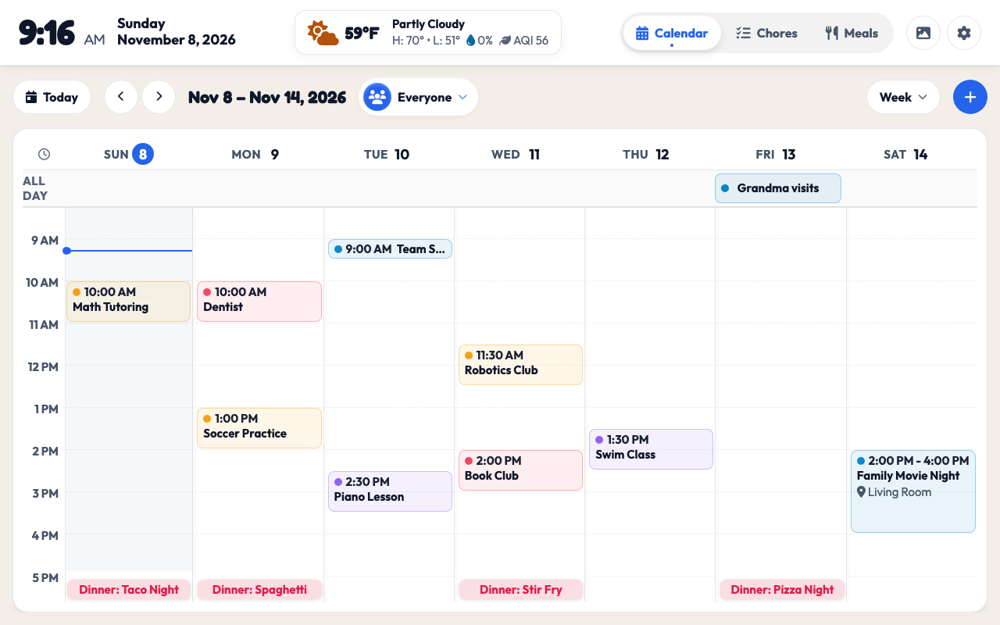
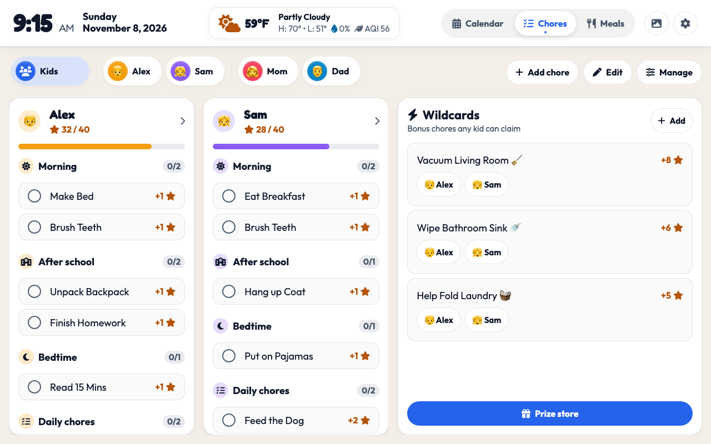
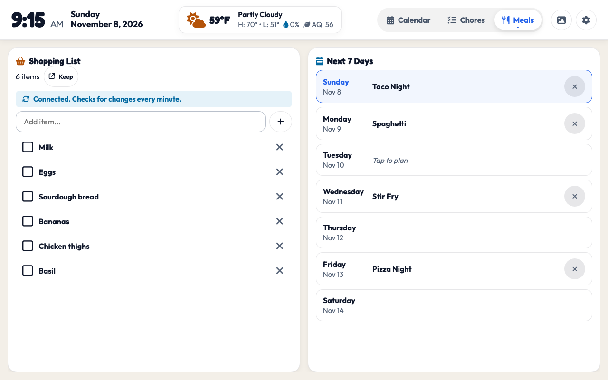

# 🏡 Family Kitchen Dashboard

A modern, wall-mounted smart display dashboard designed for kitchen touchscreens (iPad, Android tablet, Raspberry Pi touch display) or desktop displays.

[](https://my.home-assistant.io/redirect/hacs_repository/?owner=akiersky&repository=HomeDashboard&category=plugin)
[](https://github.com/hacs/default)
[](https://github.com/akiersky/HomeDashboard)
[](LICENSE)

---

## 📸 Screenshots

### 📅 Family Calendar
Color-coded week view for the whole family, with a person filter and view picker (Week, 3-Day, Month, Agenda):


### ⭐ Chores & Star Rewards
Gamified chore charts for kids, routine checklists, wildcard bonus missions, and prize store:


### 🍽️ Meals & Grocery Planner
7-day dinner planner synced with Google Keep and Home Assistant shopping lists:


---

## ✨ Features

- 📅 **Unified Family Calendar:**
  - Multi-member color-coded schedule with Google Calendar & Home Assistant calendar entity sync.
  - Week, 3-Day, Month and Agenda views, picked from a dropdown next to an Everyone / one-person filter.
  - Time grids that open at the current hour, attendee indicator dots, and automatic 5-minute background sync.
  - Add events with a start and optional end time, or as all-day events.
  - The dinner plan stays pinned to the bottom of each day column, and the time grid always scrolls far enough to clear it.
- ⭐ **Chore Charts & Gamified Missions:**
  - Side-by-side routines for kids (morning, afterschool, bedtime), with one tap from the person pills to each kid's own page.
  - Daily, weekly, and monthly chore cadences.
  - Bonus **Wildcard Chores** that can be claimed on a first-come, first-served basis.
  - Star earning, streaks, achievements, and an in-app **Prize Store** where stars can be redeemed for parent rewards.
- 🔒 **Parent PIN Gate:**
  - Built-in PIN protection for sensitive parental controls (editing chores, managing stars, configuring settings, or approving prizes).
- 📺 **Built-in Kiosk Mode:**
  - Toggle in Settings to hide Home Assistant's navigation sidebar and top titlebar for a true edge-to-edge wall tablet display. Powered by the [WallPanel](https://github.com/j-a-n/lovelace-wallpanel) integration (install it from HACS first); the toggle reloads the page with WallPanel's `wp_*` URL options.
  - Device-specific: wall tablets run in full-screen kiosk mode without forcing desktop browsers into kiosk mode.
  - URL safety escape: append `?disable_kiosk` or `?kiosk=0` anytime to instantly bypass kiosk mode.
- 🍽️ **Meal Planning & Groceries:**
  - Weekly dinner plan (next 7 days) with quick pinning to the calendar.
  - Meal ideas bank with easy search and one-click dinner scheduling.
  - Direct bi-directional sync with Home Assistant to-do entities (e.g. Google Keep shopping list sync).
- 🌦️ **Live Weather & Air Quality:**
  - Current conditions, high/low, precipitation probability, and Air Quality Index (AQI).
  - 5-day horizontal forecast and interactive Windy radar centered on your location.
  - Auto-detects coordinates from your Home Assistant configuration and shows the city name (looked up from the coordinates). Tap the location name in the weather popup to search for another place.
- 🖼️ **Ambient Photo Screensaver:**
  - Integrated with self-hosted **Immich** photo libraries.
  - Ken Burns slow drift animation, ambient clock & upcoming day's events overlay, and instant tap-to-wake.
- 🌙 **Night Mode:**
  - Dims the screen between set times or from sunset to sunrise, to a brightness you choose. A tap brightens it again.
- 🔄 **Native Dual-Mode Architecture:**
  - **Inside Home Assistant:** Automatically connects to your active session — zero tokens and zero URL configuration required. Works seamlessly over Nabu Casa / Home Assistant Cloud!
  - **Standalone Mode:** Can also run on an independent web server or kiosk browser outside Home Assistant using a Long-Lived Access Token.
  - **Docker Compose (no Home Assistant):** a small bundled server stands in for Home Assistant: shared household data, to-do lists, read-only iCal calendars, a photo folder or Immich screensaver, and an optional camera button. See Option 3.

---

## 🚀 Installation

### Option 1: One-Click Install via HACS (Recommended)

Click the button below to add this repository directly to your Home Assistant instance via HACS:

[](https://my.home-assistant.io/redirect/hacs_repository/?owner=akiersky&repository=HomeDashboard&category=plugin)

#### Manual HACS Installation:
1. In Home Assistant, open **HACS**.
2. Click the three dots menu in the top right corner and choose **Custom repositories**.
3. Enter repository URL:
   - **Repository:** `https://github.com/akiersky/HomeDashboard`
   - **Category:** `Dashboard` (called `Lovelace` in older HACS versions)
4. Click **Add**, find **Family Dashboard**, and click **Download**.
5. Refresh your browser when prompted.

---

### 📱 Adding to a Lovelace Dashboard (Panel View)

For the best kiosk experience, configure the dashboard as a full-screen panel view:

1. In Home Assistant, go to **Settings** → **Dashboards** → **Add Dashboard** (e.g. "Kitchen Display").
2. Edit the view and set the **View type** to **Panel (1 card)** so it fills the entire display.
3. Add a **Manual card** with the following YAML (HACS registers the resource for you; hard-refresh the browser once after installing):
   ```yaml
   type: custom:family-dashboard
   ```
4. Save and view! The dashboard will auto-authenticate using your Home Assistant session.

#### Optional: Dedicated Sidebar Panel
If you want "Family Dashboard" to appear directly in the Home Assistant left navigation sidebar, add this to your `configuration.yaml`:

```yaml
panel_custom:
  - name: family-dashboard
    sidebar_title: Family Dashboard
    sidebar_icon: mdi:view-dashboard-outline
    url_path: family-dashboard
    module_url: /hacsfiles/HomeDashboard/family-dashboard.js
```

---

### Option 2: Standalone Kiosk Server

If you prefer running the dashboard on an independent web server (e.g., dedicated Raspberry Pi, local nginx/Docker, or standalone tablet browser):

1. Clone this repository:
   ```sh
   git clone https://github.com/akiersky/HomeDashboard.git
   cd HomeDashboard
   ```
2. Copy the example configuration:
   ```sh
   cp config.example.js config.js
   ```
3. Open `config.js` and add your Home Assistant URL and a **Long-Lived Access Token** (created under your HA Profile → Security → Long-Lived Access Tokens).
4. Serve the directory with any static HTTP server:
   ```sh
   python3 -m http.server 8080
   ```
5. Navigate to `http://<device-ip>:8080/` in your browser.

---

### Option 3: Docker Compose (no Home Assistant)

A prebuilt image (Intel/AMD and Raspberry Pi) is published at `ghcr.io/akiersky/homedashboard:latest`: in `docker-compose.yml`, replace `build: .` with `image: ghcr.io/akiersky/homedashboard:latest` and skip the `--build`. The container reports its health to Docker (`/healthz`).

Everything runs from one container. The dashboard is the same; a small Node server (`server/`) answers the few Home Assistant calls it makes.

```sh
git clone https://github.com/akiersky/HomeDashboard.git
cd HomeDashboard
mkdir docker-data                # must be writable by uid 1000 (the container user)
cp server/server.example.json docker-data/server.json
cp config.example.js docker-data/config.js   # optional: family name and members
docker compose up -d --build
```

Open `http://<this-machine>:8080`. Edit `docker-compose.yml` first to set your timezone (`TZ`) and, for the screensaver, a photo folder to mount at `/photos`. Edit `docker-data/server.json` to turn features on (no restart needed; calendars are cached for five minutes):

| Feature | `server.json` | In the dashboard |
|---|---|---|
| Calendars (read-only) | `"calendars": { "calendar.mom": "<secret iCal URL>" }` (Google: Calendar settings → *Secret address in iCal format*; iCloud, Outlook and Nextcloud share iCal links too) | Settings → each member's calendar entity: pick `calendar.mom` |
| Screensaver photos | `"photos": { "image.photos": <source> }`, one of the sources below. With no `photos` set, it shows the `nature` theme. | Works as is: the screensaver entity defaults to `image.photos` |
| Camera button | `"cameras": { "camera.front_door": "http://go2rtc:1984/api/stream.mjpeg?src=front_door" }`: any MJPEG or snapshot URL | Settings → Doorbell → Camera Entity `camera.front_door`; a camera button appears in the header |
| Weather location and day/night theme | `"location": { "latitude": …, "longitude": …, "name": "Home" }` | Weather location can also be set in Settings → Weather. With a location here, the theme follows the sun. |

**Photo sources** (the `<source>` above):
- `{ "type": "theme", "theme": "nature" }`: pictures around a theme, the default. Themes: `nature`, `mountains`, `sunsets`, `flowers`, `space`, `food`; or any category with `"category": "Featured pictures of birds"`. They come from Wikimedia Commons featured pictures (free licenses, no account or key). The caption credits the photographer, and the tablet's server needs internet access.
- `{ "type": "folder", "path": "/photos" }`: a folder mounted in `docker-compose.yml`, including subfolders. A Nextcloud, Synology or PhotoPrism library works if you mount or sync its folder.
- `{ "type": "immich", "url": "http://immich:2283", "apiKey": "…" }`: random favorites. Add `"albumId": "…"` for one album, or `"favoritesOnly": false` for any photo.
- `{ "type": "urls", "urls": ["https://…/a.jpg", "…"] }`: your own list of picture links.

Google Photos has no way in: its API no longer lets other apps read your library. Export or sync the photos to a folder instead.

**Lists:** the shopping list, meal ideas and dinner plan are stored on the server and shared by every tablet. Use any entity name you like in Settings (`todo.groceries`); it is created on first use. Without a grocery entity the list is still shared through the household data.

**What is different without Home Assistant**
- No Google Keep sync, and calendars are read-only (the dashboard never writes to calendars anyway).
- A doorbell *press* is not detected on its own. Have your doorbell, camera (Frigate, go2rtc, …) or any script call the server, and the popup and chime appear on every tablet: `curl -X POST http://<this-machine>:8080/api/webhook/binary_sensor.front_door` (add `-u :<password>` if you set one). Put the same name in Settings → Doorbell → Press Entity. The header button shows the camera on demand either way.
- Without a `location` in `server.json` the theme follows the clock (7:00 to 20:00 is day) instead of the sun. Kiosk Mode (WallPanel) needs Home Assistant; use your browser's or Fully Kiosk's kiosk setting instead. The Home Assistant section of Settings is hidden.
- **There is no login unless you set one.** Anyone who can reach the port can read and change the household data and see the camera. Uncomment `PASSWORD` in `docker-compose.yml` to ask for a password (any user name) before anything is shown; the browser asks once and remembers it. Don't put the password in the kiosk URL (`http://user:pass@…` breaks the dashboard's requests); fill in your kiosk browser's own password setting instead. The password is not encrypted on the wire: for use outside your home network, put the server behind HTTPS (Caddy, Cloudflare Tunnel, …).
- Themed photos are fetched from Wikimedia (once a day for the picture list, plus each photo shown); nothing about your household is sent. Choose a folder, Immich or URL source to keep photos off the internet.
- Back up `docker-data/` (`state.json` holds everything shared).

---

## ⚙️ Configuration & Personalization

All household data and settings are configurable directly inside the dashboard UI by clicking the **Gear icon** in the top header:

- **Family Members:** Add, edit, or color-code parents and children.
- **Calendars:** Map each family member to their Home Assistant calendar entity (`calendar.personal`, `calendar.family`, etc.).
- **To-Do & Grocery Lists:** Link your shopping list, meal ideas, and meal plan entities (e.g. `todo.google_keep_shopping_list`, `todo.meal_ideas`).
- **Doorbell Camera Popup:** Optionally configure a doorbell sensor and camera entity to automatically pop up live camera feeds when the doorbell rings.
- **Screensaver:** Configure idle timeout (minutes) and photo rotation interval.

### 🛡️ Data Safety, Privacy & Updates
- **Your data never ships with the plugin.** The repository contains only generic demo data (Mom, Dad, Alex, Sam). Your household data, tokens and PIN are created on your own devices.
- **Where data lives:** in the browser (`localStorage`) of each display, plus a shared copy in your Home Assistant user storage (`frontend/set_user_data`). Nothing is sent to any server other than your own Home Assistant, plus public weather lookups (Open-Meteo) and a city-name lookup (BigDataCloud) using your coordinates.
- **Updates are safe:** updating through HACS replaces only `family-dashboard.js`. Stored data is never overwritten: the demo data is used only on a device's very first run, the shared copy with the newest edit wins, and older saved data is migrated forward.
- **No token needed inside Home Assistant.** The card reuses your logged-in session. In standalone mode, the Long-Lived Access Token and Immich key stay on that one device: they are never synced to Home Assistant and never included in backups.
- **Parent PIN:** a guard against kids, not a security boundary. It defaults to `1234` until you set one, and is stored in your Home Assistant user storage.
- **Standalone `config.js`** holds your token in plain text on the web server that serves it. Keep that server on your LAN and never commit `config.js` (it is git-ignored).
- **The card runs inside Home Assistant's own origin** (same-origin iframe), so treat the dashboard like any custom card: install only from sources you trust.
- **Export / Import:** **Settings → General → Data & Backup** downloads a `.json` backup (without tokens or PIN) and restores it on another device.

---

## 🛠️ Development & Building

The dashboard uses plain vanilla web standards with no external build tools or npm dependencies required:

- **Source files:** Modular source files live in [`src/`](src/) (e.g. `src/calendar-feed.js`, `src/mission-ledger.js`, `src/kiosk-mode.js`).
- **Compile bundles:**
  ```sh
  node scripts/build.js
  ```
  This zero-dependency script assembles `src/` into `js/bundle.js` (for standalone/local testing) and `family-dashboard.js` (the single-file HACS distribution).
- **Run unit tests:**
  ```sh
  node --test "tests/**/*.test.js"
  ```
  Runs Node's built-in test runner, including an automated check verifying `js/bundle.js` is up-to-date with `src/`.
- **Browser smoke suite:**
  ```sh
  tests/browser/sandbox.sh
  python3 -m http.server 8766 --directory "$TMPDIR/family-dashboard-sandbox"
  ```

---

## 📄 License

This project is open source and available under the [MIT License](LICENSE).
